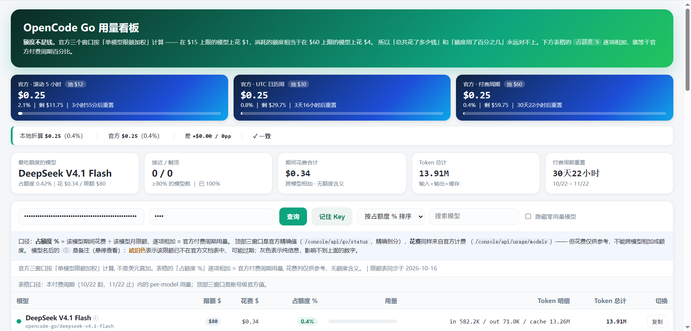

# opencode-go-usage

OpenCode Go 订阅用量看板：三个官方额度窗口、每个模型的额度占用与花费，一屏看完，方便按余量换模型。



纯 Python 标准库代理 + 单页前端，零依赖、无构建，Docker 直跑。

## 部署

### 本地

```powershell
python server.py --port 8765
```

浏览器打开 `http://localhost:8765`，填 Service Account Key（`oc_sk_...`）查询。

### Docker / NAS

```bash
# 先把 docker-compose.yml 里的 VIEWER_PIN 改成你自己的强 PIN
docker compose up -d
```

浏览器打开 `http://服务器IP:8765`，填 PIN + Key 查询。

| 变量 | 说明 |
| --- | --- |
| `VIEWER_PIN` | 访问 PIN。**不设等于没有鉴权**，外网暴露前必须改成强 PIN |
| `CONSOLE_API_KEY` | 可选，服务端预置 Key；设了之后页面可不填 |
| `PORT` / `HOST` | 监听端口 / 地址，默认 `8765` / `127.0.0.1` |
| `CONSOLE_URL` / `ZEN_URL` | 上游地址，默认官方；可指向本地 mock 离线调试 |

改了 `server.py` 需 `docker compose restart go-usage` 才生效（`index.html`、`GO_LIMITS.json` 刷新页面即可）。
如需从外网访问，请自行在前面加一层 HTTPS，不要把 8765 裸暴露到公网。

## 更新日志

* 2026-10-22：修复续订后表格仍显示上一周期用量 —— per-model 查询改为按付费周期起点过滤，表格上方新增「表格口径」一行
* 2026-10-16：顶部三窗口改用 `go/status` 官方精确金额；「占额度 %」修正为按模型限额加权，新增限额表自检对账条
* 2026-09-26：表头新增官方总体用量条；数据源迁移到 `/api/usage/models`

更早的变更见 `git log`。

## License

MIT
